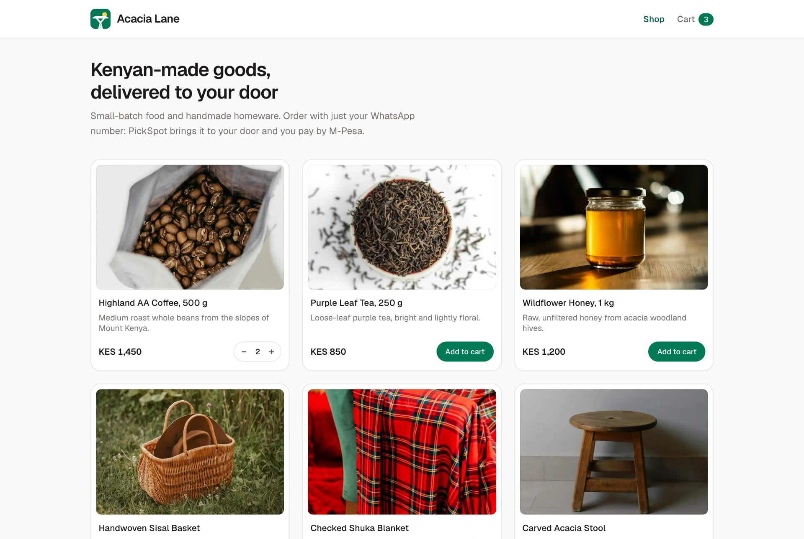
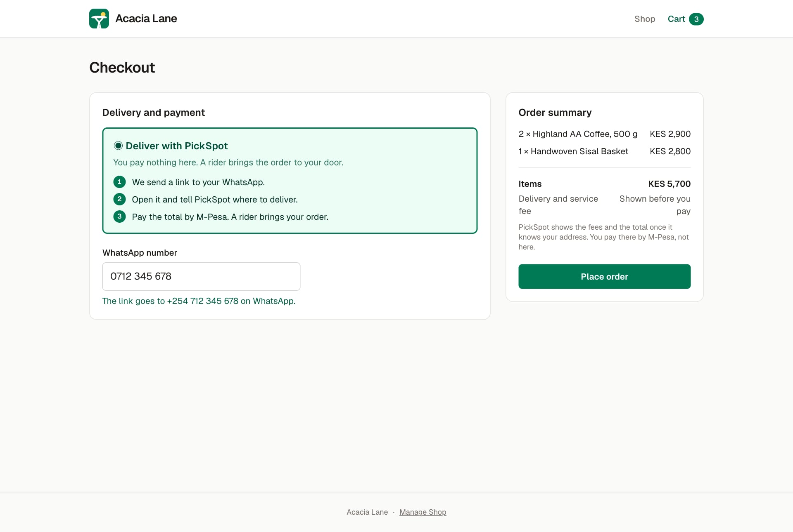
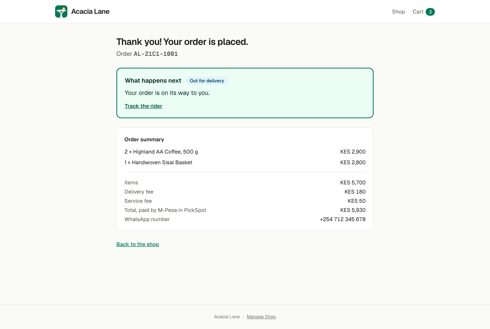
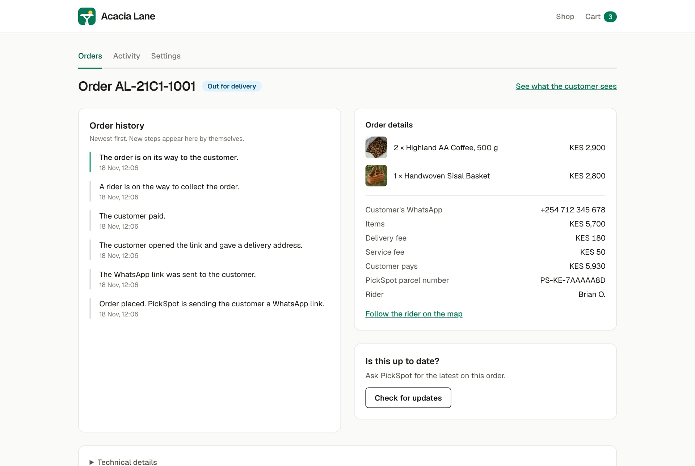
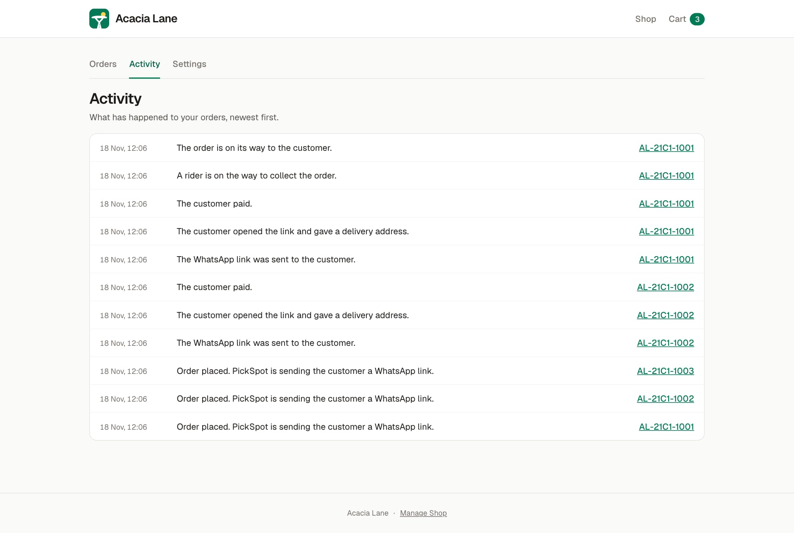
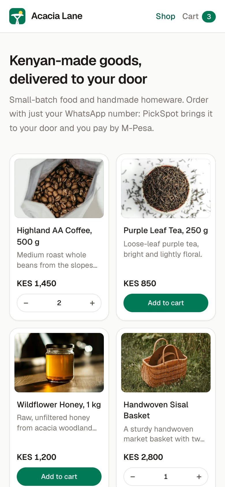
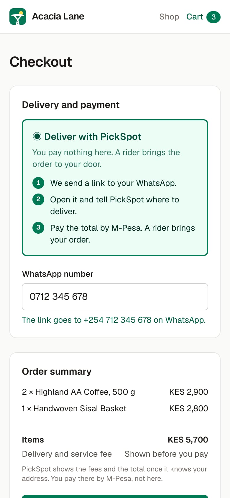
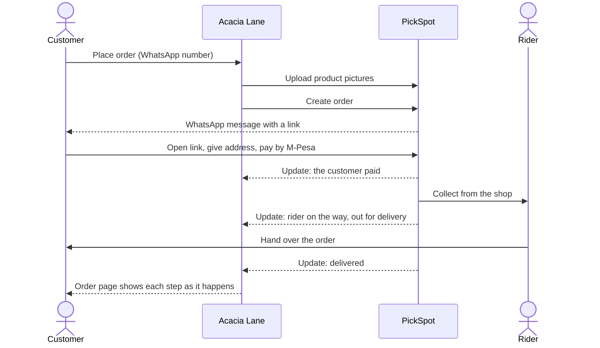

# Acacia Lane

An online shop for Kenyan-made goods, with delivery and payment handled by
[PickSpot](https://pickspot.world). A customer orders with nothing but a
WhatsApp number; PickSpot sends them a link, they say where to deliver, pay by
M-Pesa, and a rider brings the order to their door. The shop follows every
step and shows it in plain words, to the customer and to the shop owner.



| Checkout | The customer's order page |
| --- | --- |
|  |  |

| The owner's view of an order | Activity across all orders |
| --- | --- |
|  |  |

It is built for phones first:

<p>
  
  
</p>

The orders and phone numbers in the screenshots are made up.

## What it does

**For customers**

- Browse six products, fill a cart, check out.
- Check out with one field: a WhatsApp number, typed any way they like
  (`0712 345 678`, `712345678`, `+254 712 345 678`).
- Pay nothing in the shop. PickSpot collects the total by M-Pesa once the
  customer has confirmed their delivery address.
- Follow the order on a page that updates by itself: waiting, paid, rider on
  the way, out for delivery, delivered.

**For the shop owner**

- See every order, its status and what the customer will pay.
- Read each order's history in plain sentences ("The customer paid", "A rider
  is on the way to collect the order").
- Watch one Activity feed across all orders.
- Connect the shop to PickSpot on a single Settings page.

**Under the bonnet**

- Places orders with PickSpot, with product pictures attached.
- Receives PickSpot's updates on a webhook, checks each one is genuine, and
  ignores repeats and late arrivals.
- Catches up by asking PickSpot directly whenever an update goes missing.
- Has a practice mode with a pretend PickSpot, so the whole flow can be tried
  with no account, no API key and no internet.

## Quick start

You need [Node.js](https://nodejs.org) 20.9 or newer.

```bash
git clone https://github.com/jnicolao/acacia-lane.git
```

```bash
cd acacia-lane
```

```bash
npm install
```

```bash
npm run dev:practice
```

Open <http://localhost:3000>. Add something to the cart, check out with any
mobile number, then open **Manage shop** in the footer and play the customer
and the rider from the order's page. [Getting started](docs/getting-started.md)
walks through it step by step, and through connecting a real PickSpot account.

## How an order travels



## Documentation

| Guide | What is in it |
| --- | --- |
| [Getting started](docs/getting-started.md) | Install, try practice mode, connect a real PickSpot account |
| [How it works](docs/how-it-works.md) | The parts of the shop, how they fit, what is stored and why it is built this way |
| [Working with PickSpot](docs/pickspot-integration.md) | Every call the shop makes, the order it sends, the updates it receives and how it checks them |
| [Settings and data](docs/configuration.md) | The Settings page, environment variables, data files, who can open what |
| [Putting it online](docs/deployment.md) | Running it for real, and the two things to sort out first |
| [Making it yours](docs/customising.md) | Change the name, the products, the photos and the wording |
| [Testing](docs/testing.md) | The automated tests, practice mode as a test bench, a checklist for a real run |
| [When something is wrong](docs/troubleshooting.md) | Symptoms, causes and fixes |

## Built with

- [Next.js 16](https://nextjs.org) (App Router) and [React 19](https://react.dev)
- [TypeScript](https://www.typescriptlang.org)
- [Tailwind CSS 4](https://tailwindcss.com)
- [Vitest](https://vitest.dev) for the tests
- No database and no other services: the shop keeps its data in files

## Where things are

```text
app/
  icon.svg                      the logo, in the header and the browser tab
  page.tsx                      the shop's front page
  cart/  checkout/              cart and checkout
  orders/[reference]/           the customer's order page
  orders/actions.ts             catch-up: ask PickSpot about an order
  admin/orders/                 the owner's orders and each order's page
  admin/activity/               everything that happened, newest first
  admin/settings/               the PickSpot connection
  admin/actions.ts              what the owner's buttons do
  api/checkout/orders/          places an order
  api/pickspot/webhook/         receives PickSpot's updates
components/                     cart, checkout form, owner's forms, badges
lib/
  brand.ts                      the shop's name
  products.ts                   the catalogue
  wording.ts                    PickSpot's codes turned into plain words
  phone.ts                      reading phone numbers
  checkout.ts                   building the order sent to PickSpot
  item-images.ts                uploading product pictures
  pickspot.ts                   the PickSpot client
  pickspot-mock.ts              the pretend PickSpot for practice mode
  signature.ts  webhook.ts      checking and applying PickSpot's updates
  orders.ts  db.ts  data-file.ts  orders and where they are kept
  settings.ts  local-only.ts    settings, and who may open the owner's side
public/products/                product photos
docs/                           the guides listed above
```

## Commands

| Command | What it does |
| --- | --- |
| `npm run dev:practice` | Runs the shop in practice mode |
| `npm run dev` | Runs the shop against the real PickSpot |
| `npm test` | Runs the automated tests |
| `npm run typecheck` | Checks the types |
| `npm run lint` | Checks the code style |
| `npm run build` | Builds the shop for production |
| `npm start` | Runs the production build |

## Where it stands

The shop works end to end on one computer. Before it can live on the internet
two things need doing, both described in [Putting it online](docs/deployment.md):

- **The owner's side has no sign-in.** It only opens on the computer the shop
  runs on.
- **Data is kept in files.** That suits a server with a lasting disk, not
  hosting that starts fresh for every request.

Also worth knowing: the customer's order page can be opened by anyone who
knows the order number, and product pictures reach PickSpot only if PickSpot
accepts picture uploads from the shop's API key.

## Credits

Product photos are from [Unsplash](https://unsplash.com), used under the
[Unsplash License](https://unsplash.com/license) and cropped to 1200 × 800.

| Product | Photo by | Source |
| --- | --- | --- |
| Coffee | Nadia Valko | <https://unsplash.com/photos/7QlJ79Cj43w> |
| Tea | petr sidorov | <https://unsplash.com/photos/T9yWxecVV2Q> |
| Honey | Jonathan Pielmayer | <https://unsplash.com/photos/0em3k8ebFCs> |
| Basket | Gaby Baldiskaite | <https://unsplash.com/photos/1qSnrIRUu5U> |
| Blanket | Eugenia Pan'kiv | <https://unsplash.com/photos/H2-n87z9_6g> |
| Stool | Menna Ahmed | <https://unsplash.com/photos/crkAggG6UQw> |
