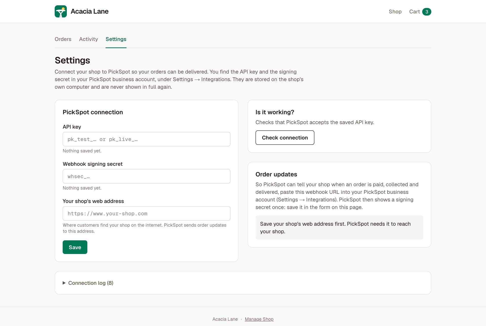

# Settings and data

What can be set, where it is kept, and who can reach it.

- [The Settings page](#the-settings-page)
- [Environment variables](#environment-variables)
- [Data files](#data-files)
- [Who can open what](#who-can-open-what)
- [How secrets are handled](#how-secrets-are-handled)
- [Practice mode](#practice-mode)

## The Settings page

At `/admin/settings`, under **Manage shop → Settings**. It is the one page
that uses PickSpot's own technical names, because those are the names in the
PickSpot business account where the values come from.



| Field | What to put in it | Where it comes from |
| --- | --- | --- |
| **API key** | The key that lets the shop place orders | PickSpot business account → Settings → Integrations. Shown once when created |
| **Webhook signing secret** | The secret that proves an update came from PickSpot | Shown once, when you set the webhook URL in the PickSpot account |
| **Your shop's web address** | Where the shop can be reached on the internet, for example `https://www.your-shop.com` | Your own domain, or a tunnel address while testing |

Leaving the API key or the signing secret empty keeps the saved one. To
replace one, paste the new value and save.

| Button or section | What it does |
| --- | --- |
| **Save** | Stores the three values |
| **Check connection** | Asks PickSpot whether the saved API key works, names the business it belongs to, and says if no pickup location is set |
| **Order updates** | Shows the webhook URL to paste into the PickSpot account: the shop's web address followed by `/api/pickspot/webhook`. Appears once a web address is known |
| **Connection log** | Every update PickSpot has sent, newest first: whether the signature was right, what the shop did with it, and the body. Collapsed until opened |

## Environment variables

Set where the shop is started. For local use, copy `.env.example` to
`.env.local`; Next.js reads it by itself, and it is never committed.

| Variable | Needed | What it does |
| --- | --- | --- |
| `PICKSPOT_API_URL` | For real orders | The address of the PickSpot API, ending in `/api/v1`. Without it "Check connection" says the shop has not been told where PickSpot is. It is not on the Settings page on purpose: it is decided by whoever installs the shop, not by the owner |
| `PUBLIC_URL` | No | The shop's public web address. Used only when none is saved on the Settings page; a saved address wins |
| `PICKSPOT_MOCK` | No | Set to `1` for [practice mode](#practice-mode). `npm run dev:practice` sets it for you |
| `DATABASE_URL` | On Vercel and similar | A Postgres connection string. When it is set the shop keeps its data in that database instead of in files (see [A database instead of files](#a-database-instead-of-files)). Vercel sets it by itself when a Neon database is connected to the project |

Example, for one run:

```bash
PICKSPOT_API_URL=https://api.example.com/api/v1 npm run dev
```

## Data files

The shop keeps everything in a folder named `.data` next to the code. It is
created on first use and is never committed.

| File | Contents | Mode |
| --- | --- | --- |
| `settings.json` | API key, signing secret, shop's web address | Both |
| `store.json` | Orders, the order counter, the log of updates received | Real |
| `store.mock.json` | The same, for practice orders, plus the pretend PickSpot's own view of each order | Practice |
| `image-keys.json` | Which product pictures have been uploaded, and their keys | Real |
| `image-keys.mock.json` | The same, for practice | Practice |

Things to know:

- **Deleting a file resets what it holds.** Stop the shop first.
- **Back up `store.json` and `settings.json`** if the orders matter. There is
  no other copy.
- **The log is trimmed** to the last 1,000 updates, and each logged body to
  20,000 characters.
- **Writes are safe against a crash**: each file is written under a temporary
  name and then swapped in.
- **One shop, one folder.** Two copies of the shop must not share a `.data`
  folder.

### A database instead of files

When `DATABASE_URL` is set, the same documents are kept in a Postgres table
named `shop_data` instead, one row per file name above. The shop creates the
table itself the first time it runs. This is how it runs on Vercel, where
files do not last.

- **Several copies of the shop can share it.** A change locks its row until
  it is saved, so two copies never hand out the same order number or lose an
  update that arrived at the same moment.
- **Reads come from a shared cache**, emptied whenever a document is saved.
  Pages that redraw every few seconds therefore do not keep asking the
  database, which lets a free database sleep when nothing is happening.
- **The practice rows stay apart** (`store.mock.json`, `image-keys.mock.json`),
  as the practice files do.
- **`.env.local` decides it on your computer too.** With `DATABASE_URL` in
  `.env.local`, `npm run dev` and `npm run dev:practice` use that database.
  Leave it out to use files.
- **Back up the database** if the orders matter.

**Times** are stored in UTC and shown in Kenyan time (Africa/Nairobi),
wherever the server is. Change `timeZone` in `lib/format.ts` to show another.

## Who can open what

| Part of the shop | Who can open it |
| --- | --- |
| The shop, cart and checkout | Anyone |
| An order page (`/orders/<order number>`) | Anyone who knows the order number |
| The webhook URL | Anyone can send to it; only updates with the right signature are believed |
| **Manage shop** (`/admin/...`) and its buttons | Only a browser on the computer the shop runs on |

The owner's side has no sign-in. Instead, `lib/local-only.ts` looks at the
address the request was made to. If the request came to `localhost` it is let
in; if it came through a public address (a domain or a tunnel) it gets a page
saying "This area is for the shop owner". The check is made by every owner's
page and again by every owner's button, because a button's action can be
called without visiting its page.

This is enough for a shop running on your own computer. It is not enough for a
hosted shop: see [Putting it online](deployment.md#1-give-the-owner-a-way-in).

Order pages are not private. An order number has a random part, but it is
short and the counter after it is predictable. Do not rely on it to keep an
order's contents secret.

## How secrets are handled

- The API key and the signing secret are read on the server each time they
  are needed. No page, script or response sent to the browser contains them.
- The Settings page shows a saved value masked: the first few characters, a
  row of dots, the last four. That is enough to tell which key is saved and
  not enough to use it.
- The API key is sent to exactly one place: the address in `PICKSPOT_API_URL`,
  in the `x-api-key` header.
- When PickSpot says a phone number belongs to someone's account, the details
  are dropped before anything is stored or shown.
- `.data/` and `.env.local` are in `.gitignore`.
- With a database, the saved settings are in the database and its shared
  cache, on the same hosting as the shop.

## Practice mode

Started with `npm run dev:practice`, or by setting `PICKSPOT_MOCK=1`.

- PickSpot is replaced by a pretend one inside the shop. Nothing is sent
  anywhere.
- No API key or PickSpot address is needed.
- A yellow banner on every page says practice mode is on.
- Orders go to `store.mock.json`, so practice never mixes with real orders.
- The owner's order page gains a box for playing the customer and the rider.

Leave `PICKSPOT_MOCK` unset on a hosted shop.

Next: [Putting it online](deployment.md).
