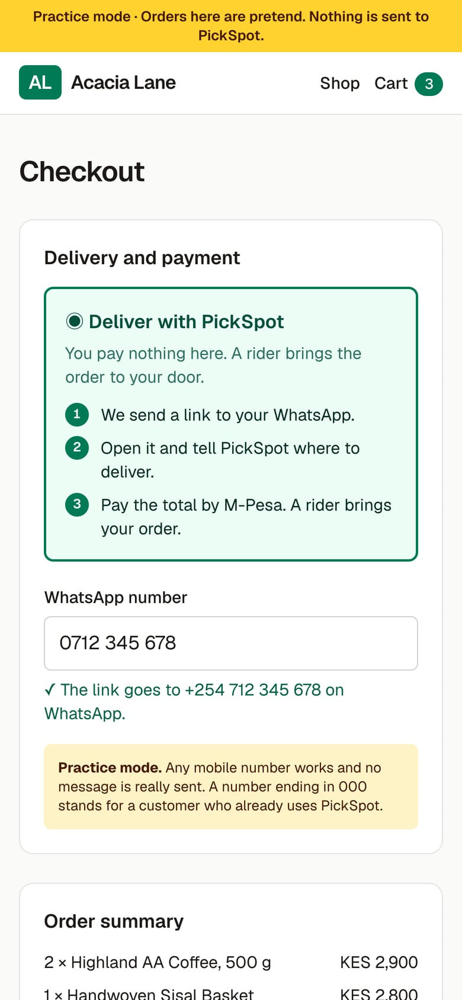
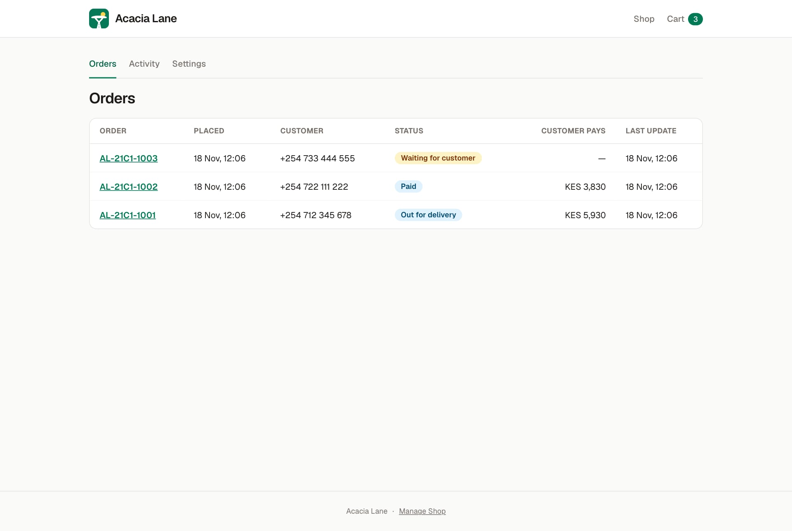
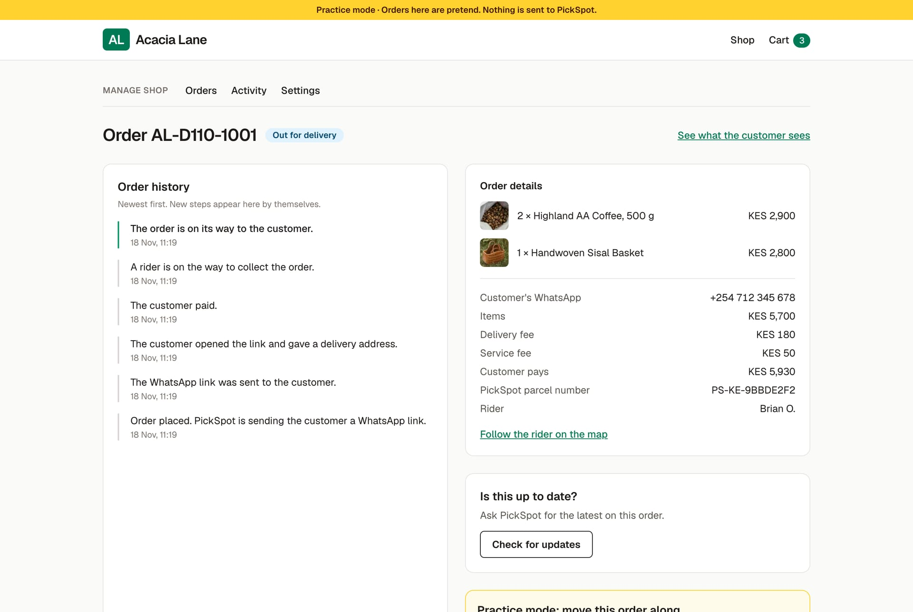

# Getting started

This guide takes you from nothing to a working shop twice: first in practice
mode, where everything is pretend, then connected to a real PickSpot account.

- [What you need](#what-you-need)
- [Install](#install)
- [Try it in practice mode](#try-it-in-practice-mode)
- [Connect a real PickSpot account](#connect-a-real-pickspot-account)
- [Starting over](#starting-over)

## What you need

- [Node.js](https://nodejs.org) 20.9 or newer. Check with `node -v`.
- For the real connection only: a PickSpot business account with an API key,
  and a way to give your computer a public web address (see
  [step 3](#3-give-the-shop-a-public-address)).

## Install

```bash
git clone https://github.com/jnicolao/acacia-lane.git
```

```bash
cd acacia-lane
```

```bash
npm install
```

## Try it in practice mode

Practice mode swaps PickSpot for a pretend one that lives inside the shop.
No account, no key, no internet. A yellow banner on every page shows it is on.

```bash
npm run dev:practice
```

Open <http://localhost:3000>.

### 1. Place an order

1. Press **Add to cart** on a product or two.
2. Open **Cart**, then **Checkout**.
3. Type any mobile number, for example `0712 345 678`. Under the field the
   shop shows the number as it understood it: "The link goes to
   +254 712 345 678 on WhatsApp".
4. Press **Place order**.

You land on the customer's order page. It says to check WhatsApp for a link.
In practice mode no message is really sent.



### 2. Play the customer and the rider

1. Scroll to the footer and open **Manage shop**. This is the owner's side.
2. Open your order from the list.

   

3. Find the yellow box **Practice mode: move this order along**. Pick "The
   customer opened the link and gave a delivery address" and press **Make it
   happen**.
4. Do the same with "The customer paid", then "A rider is on the way to
   collect the order", "The order is on its way to the customer" and "The
   order was delivered".

Each step appears in **Order history** on the left, newest first. The badge
next to the order number changes with it.



### 3. See it from the customer's side

Press **See what the customer sees** at the top of the order. The customer's
page has followed along: it shows the same status, the fees and the total.
While the order waits for the customer, it has a **Copy the link** button, so
the WhatsApp link can be shared if the message did not arrive.

### 4. Look at Activity

**Activity** in the owner's menu lists what happened across all orders.

### Things to try

- A number ending in `000` stands for a customer who already uses PickSpot.
  The order goes through exactly the same way; that is the point. See
  [When the number already has an account](pickspot-integration.md#when-the-number-already-has-an-account).
- A number that is not a phone number, such as `0712`. The checkout says so
  and nothing is sent.

## Connect a real PickSpot account

Stop practice mode (Ctrl+C) before you start.

### 1. Tell the shop where PickSpot is

Copy the example settings file:

```bash
cp .env.example .env.local
```

Open `.env.local` and set `PICKSPOT_API_URL` to the address PickSpot gave you
with your account. It ends in `/api/v1`. The file is never committed.

### 2. Start the shop and save your API key

```bash
npm run dev
```

1. Open <http://localhost:3000/admin/settings>.
2. In your PickSpot business account, open Settings → Integrations and create
   an API key. PickSpot shows it once.
3. Paste it into **API key** and press **Save**.
4. Press **Check connection**. It should say "Connected to PickSpot as" and
   your business name. If it adds that a pickup location is missing, set one
   in your PickSpot account: riders need to know where to collect orders.

You can place orders now. The next two steps make the shop hear about what
happens to them.

### 3. Give the shop a public address

PickSpot sends updates to the shop over the internet, and it cannot reach
`localhost`. While the shop runs on your computer, a tunnel gives it a public
address. In a second terminal, start either one:

```bash
cloudflared tunnel --url http://localhost:3000
```

```bash
ngrok http 3000
```

Each prints an address starting with `https://`. Paste it into **Your shop's
web address** on the Settings page and press **Save**. A free tunnel gets a
new address every time it starts, so update the field when it changes.

### 4. Switch on order updates

1. The Settings page now shows a webhook URL under **Order updates**. Copy it.
2. In your PickSpot business account, under Settings → Integrations, set it
   as the webhook URL.
3. PickSpot shows a signing secret once. Paste it into **Webhook signing
   secret** on the Settings page and press **Save**.

From now on, when a customer pays or a rider collects an order, the order's
page changes within seconds.

If you skip steps 3 and 4 the shop still works. An order then updates only
while its page is open, by asking PickSpot every 15 seconds, and the owner's
pages show a "Live updates are off" notice.

### 5. Place a real order

Use a WhatsApp number you can read. You get the link on WhatsApp, open it,
give an address, approve and pay in PickSpot. Watch the order's history fill
in. [Testing](testing.md#a-real-end-to-end-run) has a full checklist.

## Starting over

The shop keeps everything in the `.data` folder:

| File | Holds | Delete it to |
| --- | --- | --- |
| `store.json` | Real orders and the log of updates | Clear all real orders |
| `store.mock.json` | Practice orders | Clear all practice orders |
| `settings.json` | The API key, the signing secret, the shop's address | Disconnect from PickSpot |
| `image-keys.json`, `image-keys.mock.json` | Which product pictures were already uploaded | Upload every picture again |

Stop the shop before deleting a file, then start it again.

Next: [How it works](how-it-works.md).
