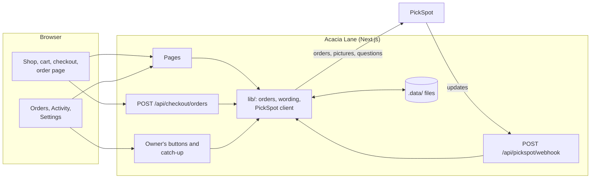
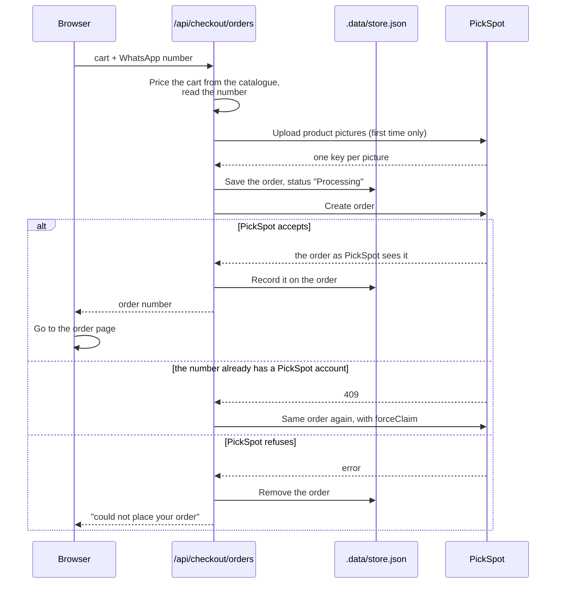
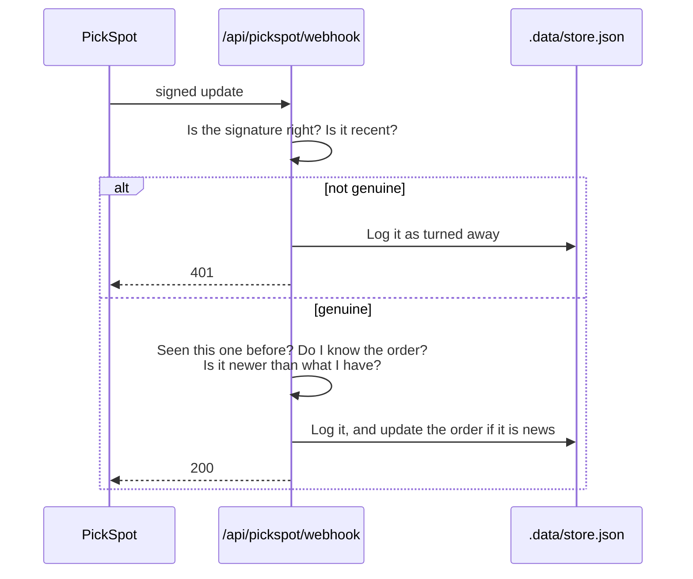

# How it works

What the shop is made of, how the parts talk to each other, what it remembers,
and why it is built the way it is.

- [The big picture](#the-big-picture)
- [Placing an order](#placing-an-order)
- [Hearing about an order](#hearing-about-an-order)
- [Catching up](#catching-up)
- [What the shop remembers](#what-the-shop-remembers)
- [The parts, file by file](#the-parts-file-by-file)
- [Why it is built this way](#why-it-is-built-this-way)

## The big picture

Acacia Lane is one Next.js application. It serves the pages people see, and
it runs the code that talks to PickSpot. There is nothing else to install or
run: no database, no queue, no second service.

Three rules hold everywhere:

1. **The API key never leaves the server.** Every call to PickSpot is made by
   server code. The browser only ever talks to the shop.
2. **The shop saves first, then tells PickSpot.** An order exists in the shop
   before PickSpot hears of it, so an update can never arrive for an order the
   shop does not know.
3. **Codes stay inside.** PickSpot speaks in status codes and event names.
   They are turned into plain words in one file, `lib/wording.ts`, before
   anything reaches a page.

## Placing an order

Step by step, in `app/api/checkout/orders/route.ts`:

1. **Read the request** (`lib/checkout.ts`). The browser sends product ids and
   quantities, never prices. The shop prices the cart from its own catalogue
   and turns the phone number into international form. A cart that is empty,
   names an unknown product, or comes with something that is not a phone
   number is refused before anything else happens.
2. **Upload the pictures** (`lib/item-images.ts`). Each product photo is sent
   to PickSpot once; PickSpot answers with a key. Keys are remembered, so the
   second order for the same product uploads nothing. A failed upload does not
   stop the order: it simply goes without pictures.
3. **Save the order** with the next order number and the status "Processing".
4. **Create the order at PickSpot**, sending the body built by
   `buildOrderRequest`. The exact body is kept on the order so it can be read
   later under "Technical details".
5. **Handle the answer**. On success the shop records what PickSpot said
   (status, fees it knows so far, the customer's link). On failure it removes
   the order again, writes the reason to the server log, and tells the shopper
   in plain words.

## Hearing about an order

PickSpot calls the shop whenever something happens to an order.

The receiver (`lib/webhook.ts`) does five things with every update, in order:

1. **Checks it is genuine** (`lib/signature.ts`). See
   [Checking an update is genuine](pickspot-integration.md#checking-an-update-is-genuine).
2. **Checks it is an update at all**: it must carry an id, an event name and a
   status.
3. **Ignores repeats.** PickSpot may send the same update more than once. Each
   has an id; a second arrival of the same id changes nothing.
4. **Finds the order** by the shop's own order number, which PickSpot sends
   back with every update.
5. **Applies it only if it is news** (`lib/orders.ts`). Updates can arrive out
   of order. Each one says when PickSpot last changed the order; an update
   older than what the shop already has is recorded but does not move the
   order backwards.

Every update is logged, whatever happened to it. The log is under
"Connection log" on the Settings page.

## Catching up

Updates can go missing: the shop may be unreachable, or the signing secret may
have been changed. So while an order's page is open and the order is not
finished, the page asks the shop to check with PickSpot.

- `components/auto-refresh.tsx` redraws an open page every 3 seconds from the
  shop's own data. On the order pages, every fifth time (so every 15 seconds,
  and once when the page opens) it first calls `catchUpAction`.
- `catchUpAction` (`app/orders/actions.ts`) asks PickSpot for the order, but
  no more than once every 15 seconds per order however many pages are open,
  and never for a finished order (delivered, returned, cancelled, declined or
  expired).
- The answer is recorded only if it is news. It is marked "Caught up by asking
  PickSpot", so under "Technical details" it stays clear which changes came
  from an update and which from asking.

The owner can also ask at any time with **Check for updates**.

## What the shop remembers

Everything is in JSON files in the `.data` folder (see
[Settings and data](configuration.md#data-files)). The shapes are in
`lib/db.ts`.

**An order**

| Field | What it is |
| --- | --- |
| `reference` | The order number, for example `AL-7K2F-1001` |
| `createdAt` | When the order was placed |
| `lines` | What was bought: product, name, quantity, price each, and the key of the picture sent |
| `recipient` | The customer's WhatsApp number |
| `request` | The exact body sent to PickSpot to create the order |
| `status` | Where the order is now |
| `pickspot` | The latest full answer from PickSpot: fees, the customer's link, the rider, the tracking link |
| `pickspotUpdatedAt` | PickSpot's time for that answer; used to tell new from old |
| `timeline` | Every update recorded for the order, in the order it was recorded |

**A timeline entry**

| Field | What it is |
| --- | --- |
| `at` | When the shop recorded it |
| `source` | `checkout` (the order was placed), `webhook` (PickSpot sent it), `refresh` (the shop asked) |
| `event` | PickSpot's name for what happened, when it sent one |
| `status` | The status PickSpot reported |
| `pickspotTime` | PickSpot's time for it |
| `note` | Extra detail for whoever supports the shop |
| `ignored` | Set when the update was older than what the shop already knew |

The order history the owner reads is built from the timeline by
`orderHistory` in `lib/wording.ts`. It leaves out ignored entries and checks
that found nothing new.

**The update log** keeps the last 1,000 updates received: when, whether the
signature was right, what was done with it, and the body (up to 20,000
characters).

**Order numbers** look like `AL-7K2F-1001`: the shop's initials, four
characters chosen at random when the shop first starts, and a counter. The
random part matters. PickSpot recognises an order by this number, and if it is
given a number it has seen before it returns the old order instead of making a
new one. Without the random part, a shop whose data was reset would start
again at 1001 and get somebody's old order back.

## The parts, file by file

**Pages** (`app/`)

| File | What it shows |
| --- | --- |
| `page.tsx` | The front page: the products |
| `cart/page.tsx` | The cart |
| `checkout/page.tsx` | The checkout (the form itself is `components/checkout-form.tsx`) |
| `orders/[reference]/page.tsx` | The customer's order page |
| `admin/orders/page.tsx` | The owner's list of orders |
| `admin/orders/[reference]/page.tsx` | One order: history, details, "Check for updates", technical details |
| `admin/activity/page.tsx` | Everything that happened, newest first |
| `admin/settings/page.tsx` | The PickSpot connection and the connection log |
| `layout.tsx`, `admin/layout.tsx` | The header, footer and the owner's menu |

**Things that act** (`app/`)

| File | What it does |
| --- | --- |
| `api/checkout/orders/route.ts` | Places an order |
| `api/pickspot/webhook/route.ts` | Receives an update from PickSpot |
| `orders/actions.ts` | `catchUpAction`: asks PickSpot about an open order |
| `admin/actions.ts` | Saves settings, checks the connection, checks an order for updates, plays a practice step |

**Logic** (`lib/`)

| File | Responsibility |
| --- | --- |
| `brand.ts` | The shop's name and initials |
| `products.ts` | The catalogue; turns a cart into priced order lines and into the items PickSpot expects |
| `phone.ts` | Reads a typed phone number; formats one for display |
| `checkout.ts` | Reads a checkout request; builds the order sent to PickSpot |
| `item-images.ts` | Uploads product pictures once and remembers their keys |
| `pickspot.ts` | The PickSpot client: four calls, one place that adds the API key |
| `pickspot-mock.ts` | The pretend PickSpot used in practice mode |
| `signature.ts` | Signs and checks updates |
| `webhook.ts` | Decides what to do with an update |
| `orders.ts` | Records an answer from PickSpot on an order; tells news from old news |
| `wording.ts` | Status names, what-happened sentences, order history, the Activity feed |
| `db.ts`, `data-file.ts` | The shapes of what is stored, and reading and writing the files |
| `settings.ts` | The saved settings, the environment, practice mode on or off |
| `local-only.ts` | Decides whether a request may open the owner's side |
| `format.ts` | Money and dates |
| `types.ts` | The shapes of what PickSpot sends and expects |

**Building blocks** (`components/`)

| File | What it is |
| --- | --- |
| `add-to-cart.tsx` | The "Add to cart" button and the − 1 + stepper |
| `use-cart.ts` | The cart, kept in the browser |
| `cart-link.tsx` | "Cart" in the header, with the item count |
| `checkout-form.tsx` | The checkout form |
| `auto-refresh.tsx` | Keeps an open page current |
| `status-badge.tsx` | The coloured status label |
| `admin-forms.tsx` | The owner's forms and buttons |
| `no-webhook-notice.tsx` | The "Live updates are off" notice |
| `local-only.tsx` | What a visitor sees instead of the owner's side |

## Why it is built this way

**Files, not a database.** The shop is small and runs as one process. Reading
and writing a file is done in one go, so two requests can never half-write the
same data. The cost is that it needs a disk that lasts; see
[Putting it online](deployment.md).

**The order is saved before PickSpot is told.** PickSpot can send its first
update before it has finished answering the request that created the order.
Saving first means that update finds the order waiting.

**Old news never overwrites new.** Updates are compared by PickSpot's own time
for the order, not by when they arrived, because the internet does not
guarantee order.

**The order is not found by guessing.** An update is matched to an order by
the shop's order number, and the status is read from the update itself rather
than worked out from the event name.

**A wrong signature gets a 401, and that is final.** PickSpot retries an
update when the shop is unreachable or broken, but not when the shop says the
update is not genuine. That is why the shop also catches up by asking.

**One field at checkout.** The shop could ask PickSpot what it knows about a
number before the order is placed, and show the name on the account or the
delivery fee. It does not, on purpose: anyone could type anyone's number. The
customer sees all of that in PickSpot, after they have opened the link sent to
their own phone.

**The cart lives in the browser.** There are no customer accounts, so there is
nothing to keep on the server until the order is placed.

**Pages that show live data wait for the request.** Next.js 16 prepares pages
ahead of time unless they say otherwise. Every page that reads orders or
settings starts with `await connection()`, which tells Next.js to build it
fresh for each visit. Keep that when adding pages.

Next: [Working with PickSpot](pickspot-integration.md).
